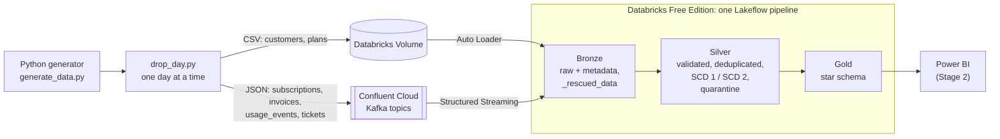

# SaaS Revenue & Churn Analytics: a streaming medallion pipeline

An end-to-end data engineering project on **synthetic SaaS data** (subscriptions, MRR, seats, invoices, product usage, support tickets). A Python generator produces data day by day, which is delivered as files and Kafka messages, cleaned in a **Bronze → Silver → Gold** pipeline on Databricks, and modelled as a **star schema** for analytics.

> **Status:** Stage 1 (data platform, up to and including the Gold layer) is complete. Stage 2 (Power BI reporting) is in preparation, see [Stage 2](#stage-2-power-bi-in-preparation).

The business question the data is built to answer: **do low seat utilization and a rising number of support tickets precede churn?**

---

## Architecture



| Layer | Technology |
|---|---|
| Data generation | Python 3.13 (numpy, pandas, Faker) |
| Ingestion | Confluent Cloud Kafka (SASL_SSL), Databricks Unity Catalog Volume, Auto Loader |
| Processing | Databricks Free Edition, Lakeflow Spark Declarative Pipelines (PySpark), Delta Lake |
| Modelling | Medallion architecture, star schema, SCD type 1 and 2 |
| Secrets | Databricks secret scope, `.env` file kept out of git |
| Reporting | Power BI (Stage 2) |

## Source data

Two delivery channels, deliberately mixed to show different ingestion patterns.

| Entity | Channel | Format | Role |
|---|---|---|---|
| `customers` | daily file in Volume | CSV | **SCD type 1** (company name corrections overwrite) |
| `plans` | single file in Volume | CSV | reference data (Starter, Growth, Enterprise) |
| `subscriptions` | Kafka topic | JSON | **SCD type 2** (new version on plan, seats or status change) |
| `invoices` | Kafka topic | nested JSON | line items, discount and payment attempts as nested structures |
| `usage_events` | Kafka topic | JSON | product usage per user (high volume) |
| `tickets` | Kafka topic | JSON | support tickets |

* About 500 customers; history from 2025-01-01. The first load (**backfill**) covers 2025-01-01 to 2026-09-30 (637 daily drops); from 2026-10-01 data is delivered **day by day** with `drop_day.py --next`, followed by a pipeline run. This is how the daily operation of the pipeline is demonstrated.
* A full backfill is 313 customer files and about 138,000 Kafka messages.
* Kafka messages are keyed by entity id (ordering per entity is preserved within a partition).
* Invoices follow a one-directional lifecycle: `paid`, `open → paid`, `open → failed → … → paid`, `open → failed → failed → uncollectible` (after 30 days, which ends the subscription with `churn_reason = payment_failure`) or `open → void`. A new full document is emitted on every status change, so Silver keeps the current state and Bronze keeps the history.
* Two churn paths: voluntary and involuntary (`payment_failure`).

## Intentionally dirty data

The generator injects about 1,600 defects and writes `dirty_manifest.csv` listing each one with its expected handling. That manifest is the answer key for the quality checks.

| Defect | Detected by |
|---|---|
| wrong data type (e.g. `"seats": "ten"`, text in a date column) | `_rescued_data` (Auto Loader for CSV, `from_json` for Kafka, including nested fields) |
| malformed JSON | `_json_malformed` flag in Bronze |
| missing keys, negative seats, unknown plan, unknown status | Silver validation rules |
| totals not matching invoice lines, paid invoice without payment date | Silver validation rules |
| events of customers that do not exist (referential integrity) | stream-static join in Silver |
| exact duplicates (same file and next day), case/whitespace variants | CDC deduplication and normalization |

## Pipeline

**Bronze** keeps everything that arrived, including bad rows. Each row carries delivery metadata (source file or Kafka topic, partition, offset, ingestion time), the original message text and `_rescued_data`. Quality expectations only count issues, they never drop rows.

**Silver** applies one principle: **validate first, then build history.**
1. Every row is checked against named rules. The first failing rule becomes the reason.
2. Failing rows go to a single `silver_quarantine` table with the reason, the original payload and the source reference. Nothing is silently lost.
3. Clean rows are normalized and processed with `create_auto_cdc_flow`: SCD 1 for customers, SCD 2 for subscriptions (history columns `plan_id`, `seats`, `status`), deduplication for usage events and tickets, current-state upsert for invoices.
4. Invoices are flattened into `silver_invoice_lines` and `silver_payment_attempts`.

Result after the backfill (every number below matched the expected value computed from the generator's manifest):

| Table | Rows |
|---|---|
| silver_customers (SCD 1) | 430 |
| silver_subscriptions (SCD 2 versions) | 841 (430 current) |
| silver_invoices / lines / payment attempts | 3,406 / 3,899 / 3,517 |
| silver_usage_events | 131,807 |
| silver_tickets | 611 |
| silver_quarantine | 559 |

Quarantine by source: usage_events 312, invoices 180, subscriptions 42, tickets 20, customers 5.

**Gold** is a star schema:

| Table | Grain / role |
|---|---|
| `fact_subscription_monthly` | subscription × month: MRR, base plan MRR, extra seats MRR, new / expansion / contraction / churned MRR, seats, active users, utilization, tickets, billed / discount / collected / outstanding / written-off amounts |
| `fact_invoice` | invoice, accumulating snapshot: status, milestone dates (issued, first failed payment, paid, closed), days to pay, overdue |
| `dim_subscription` | SCD 2: `valid_from`, `valid_to`, `is_current` |
| `dim_customer` (SCD 1), `dim_plan`, `dim_acquisition_channel`, `dim_date` | dimensions |
| `gold_signal_by_months_to_churn` | seat utilization and tickets in the months before churn vs. retained customers |

Modelling decisions worth noting:
* **MRR is contractual:** plan price plus extra seats, taken from the subscription version valid at month end. It does not depend on payments. Billing and collection are separate measures, and the **discount is a separate measure** (it does not reduce MRR).
* **SCD 2 join by date, not by `is_current`:** the version valid at month end is selected with `valid_from <= month_end < valid_to`. Joining on `is_current` would assign today's plan to historical months.
* Churned MRR is booked in the month after the last day of service.
* A subscription that starts and ends within one month has an invoice but no month-end MRR. The fact table keeps a zero-MRR row for it, so billing totals reconcile exactly.

## Validation

* **MRR reconciliation:** the generator writes `ground_truth_mrr.csv`, the MRR computed independently of the pipeline. `sql/04_reconcile_mrr.sql` compares it with Gold month by month (MRR, new, expansion, contraction, churned). All differences are 0 for every loaded month.
* **Billing reconciliation:** total billed in the fact table equals total of all non-void invoices in Silver (809,533.40 after the backfill).
* **Row counts at each layer** match the numbers computed from the dirty-data manifest.
* **No duplicate SCD 2 versions** (`subscription_id`, `__START_AT` is unique).

## Repository layout

```
generator/
  generate_data.py        # simulation of customers, subscriptions, invoices, usage, tickets + dirty data
  drop_day.py             # delivers one day: files to Volume, messages to Kafka (state kept locally)
  setup_databricks.py     # creates schema and secret scope, prints pipeline configuration
databricks/
  01_bronze.py            # Auto Loader + Kafka -> Bronze
  02_silver.py            # validation, quarantine, SCD 1 / SCD 2, deduplication
  03_gold.py              # star schema
sql/
  04_reconcile_mrr.sql    # Gold vs. ground truth
requirements.txt
.env.example              # variable names only, no values
```

## How to run

Prerequisites: Python 3.13, a free Databricks Free Edition workspace with a Volume, a Confluent Cloud cluster with four topics (`subscriptions`, `invoices`, `usage_events`, `tickets`).

1. Create a virtual environment and `pip install -r requirements.txt`.
2. Copy `.env.example` to `.env` and fill in the Kafka and Databricks values. **Never commit `.env`.**
3. `cd generator`, then `python generate_data.py` generates the data into `output/` (run the remaining Python scripts from the same folder).
4. `python setup_databricks.py` creates the schema and secret scope and prints four pipeline configuration values (`landing_path`, `kafka_bootstrap`, `kafka_api_key`, `kafka_api_secret`).
5. In Databricks, create a pipeline (default catalog `workspace`, schema `saas`), add the three files from `databricks/` as transformations and paste the configuration values.
6. `python drop_day.py --backfill` loads the history, then run the pipeline.
7. Daily demo: `python drop_day.py --next`, run the pipeline again, and new data flows through all layers.

## Databricks Free Edition notes

Only serverless compute is available, there is one active pipeline per type, and outbound internet access is limited to trusted domains (Confluent Cloud was reachable in testing). The pipeline therefore runs as an incremental batch, triggered after each daily drop (`AvailableNow`-style), not as a continuously running stream.

## Limitations

* All data is synthetic and generated with fixed random seeds. Names and figures do not describe any real company.
* The model assumes one subscription per customer.
* Silver keeps the current invoice state. The full status history stays in Bronze.

## Stage 2: Power BI (in preparation)

Stage 2 will connect Power BI to the Gold tables and publish a three-page report: revenue overview (MRR, net new MRR, ARPA, NRR), churn analysis testing the seat-utilization and tickets hypothesis, and billing health (collected vs. outstanding, failed payments). It will be added to this repository together with screenshots and the semantic model documentation.
